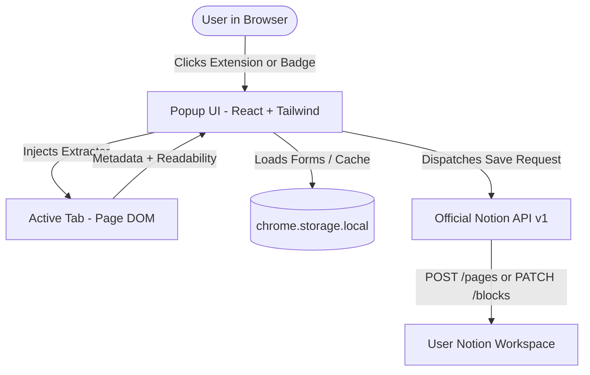

# PRD — Notion Save (Intelligent & Flexible Web Clipper)

## 1. Product Overview
**Notion Save** is a browser extension (Chrome, Edge, Brave) inspired by the experience of [Save to Notion (Save.to)](https://www.save.to). It enables users to capture articles, bookmarks, quick notes, screenshots, and structured metadata from the web directly into their Notion databases and pages with a single click, in a highly customizable and privacy-respecting manner without proprietary intermediary servers.

---

## 2. Problem & Opportunity
- The official Notion web clipper is rigid, frequently fails to extract rich metadata, and does not allow granular property mapping or flexible placement options (such as appending notes directly inside existing pages).
- Third-party tools like Save.to impose artificial limits on their free tier (e.g., maximum of 4 forms) or rely on third-party servers storing user data.
- **Notion Save Key Differentiators**:
  - **100% Free & Unlimited**: Create unlimited workflows, forms, and custom property mappings.
  - **Local-First Privacy & Security**: Direct client-to-API communication with Notion using an *Internal Integration Secret*, ensuring no third-party backend proxies or tracks user data.
  - **Databases & Pages Support**: Saves entries into relational databases or directly into standard pages (as subpages or appended content blocks).
  - **Visual Save Location Picker (Save.to style)**: Real-time search with category filters, hierarchical folder/database breadcrumbs, and workspace navigation.

---

## 3. Personas & Use Cases
1. **Content Curator / Researcher**:
   - Saves long-form articles in clean reading mode (stripping ads and clutter), automatically mapping tags, author, publication date, and summary.
2. **Developer / Designer**:
   - Clips GitHub repositories, web tools, and design references directly into a resource database or project page, including viewport screenshots.
3. **Student / Personal Productivity**:
   - Saves recipes, YouTube videos, and bookmarks with personal notes and custom reading status ("To Read", "Reading", "Completed").

---

## 4. High-Level System Architecture

---

## 5. Modules & Feature Specifications

### 5.1 Workflow & Form System
- **Unlimited Forms**:
  - Custom form title and icon (emoji or custom symbol).
  - **Save Destination**:
    - **Database**: Creates structured records with mapped table columns.
    - **Page**: Creates a **Subpage** or appends blocks to the end of an existing page (**Append block**).
  - Extraction mode: *Extract Full Article* (page body) or *Bookmark / Metadata Only*.
- **Visual Location Picker (Select a Save Location - Save.to style)**:
  - Real-time search filter matching database and page titles.
  - View filters: *Databases & Pages*, *Only Databases*, *Only Pages*.
  - Hierarchical breadcrumbs showing parent tree (`Workspace / Parent Page / ... / Name`).
  - Fluid navigation across workspaces and nested structures.

### 5.2 Property Mapping (Databases)
- Supported sources for each Notion database property:
  1. **Automatically Extracted from Page**:
     - Title (`document.title` or `og:title`)
     - URL (`window.location.href`)
     - Description / Excerpt (`meta[name="description"]` or `og:description`)
     - Cover Image (`og:image` or interactive DOM image picker)
     - Icon / Favicon (`link[rel="icon"]`)
     - Author (`meta[name="author"]` or `schema.org/author`)
     - Publication Date (`article:published_time` or current date)
     - Estimated Reading Time (word-count algorithm)
  2. **Fixed / Default Value**:
     - Example: Status always defaults to `"To Read"`, or default Tag `"Webclip"`.
  3. **Interactive User Input**:
     - Displays the input field directly in the popup form for quick entry (e.g., priority, tags, personal notes).

### 5.3 Extension Popup Interface
- **Screen 1: Form Selector**:
  - Displays configured forms with corresponding icons.
  - Instant one-click switching between different Notion destinations.
- **Screen 2: Form Input & Preview**:
  - Cover preview thumbnail with replace/remove options.
  - Interactive cover picker inspecting the active page DOM with a grid of images, plus external URL input.
  - Editable title and URL fields.
  - Dynamic Reading Mode switcher (*Full Webpage Content* vs *Bookmark Only*) with word count and estimated reading time.
  - Native Notion property field renderers:
    - **Select / Multi-select**: Renders options with official Notion badge colors; supports on-the-fly tag creation.
    - **Date**: Native date picker with clear action.
    - **Checkbox**: Interactive toggle.
    - **Text / Rich Text**: Input or multi-line textarea.
    - **Number**: Validated numeric input.
    - **Status**: Grouped status selector.
  - Primary button: **"Save to Notion"** with animated loading and success state providing a direct link to the created page.

### 5.4 Intelligent Content Extractor (Reader Mode & Metadata)
- Uses `@mozilla/readability` to eliminate ads, navigation sidebars, and cookie overlays, capturing clean article text.
- Clean transformation of HTML elements into native Notion blocks:
  - Headings `h1`, `h2`, `h3` -> `heading_1`, `heading_2`, `heading_3`
  - Text paragraphs with inline bold, italic, strikethrough, underline, inline code, and links
  - Blockquotes `blockquote` -> `quote`
  - Ordered and unordered lists -> `bulleted_list_item` and `numbered_list_item`
  - Code snippets `pre code` -> `code`
  - Images `img` -> `image` (external url)
  - Horizontal rules `hr` -> `divider`
- Specialized handlers for unique pages:
  - **YouTube**: Native Notion video player embed block.
  - **Twitter / Instagram**: Native interactive `embed` iframe blocks preserving embeds without relying on expiring CDN images, accompanied by a callout and full caption `quote` blocks.
  - **GitHub**: Repository metadata and README formatting.
- Automatic chunking for long articles (+100 blocks) using batched Notion API calls.

### 5.5 Text Highlighter
- Select text on any web page to trigger a contextual "Save to Notion" tooltip or save highlighted selections as formatted quotes in the target Notion page.

### 5.6 Image & Screenshot Capture
- **Cover Picker**: Highlights valid images in the active tab's DOM with a visual grid, allowing one-click selection as the page cover.
- **Screenshot Tool**: Captures the current visible viewport (`chrome.tabs.captureVisibleTab`) to set as page cover.

### 5.7 Notion API Authentication Strategies
- **V1 (Current — Local-First & Zero-Cost)**: **Internal Integration Secret** (`API token`).
  - Completely serverless, zero external infrastructure required.
  - Direct connection to user-authorized workspace pages.
- **V2 (Future — OAuth 2.0 via Free Cloudflare Workers)**:
  - Zero-maintenance serverless authentication bridge hosted on **Cloudflare Workers**.
  - One-click official *"Connect with Notion"* OAuth authorization flow.
  - Workspace-wide authorization without needing manual per-page invites.

---

## 6. Technology Stack
- **Extension Framework**: WXT (Manifest V3)
- **Frontend UI**: React 19 + Tailwind CSS v4 + Lucide Icons
- **Storage**: `chrome.storage.local`
- **Notion Client**: Notion REST API v1 (`2022-06-28`)
- **Content Parser**: `@mozilla/readability`
- **Future Serverless OAuth Backend**: Cloudflare Workers (Free Tier: 100k requests/day)

---

## 7. Phased Development Roadmap

### Phase 1: Foundation & MVP (Completed)
- [x] Repository and build scaffolding with WXT + React + Tailwind + TypeScript.
- [x] Notion Integration Token connection and real-time validation.
- [x] Dynamic search and listing of **Databases and Pages**.
- [x] Support for saving to **Databases** and **Pages** (as Subpage or Appended blocks).
- [x] Functional popup UI with 1-click saving and direct page link feedback.

### Phase 2: Full Property Support & Advanced Metadata (Completed)
- [x] Visual destination picker (*Select a Save Location* in Save.to style with live search and breadcrumb hierarchy).
- [x] Custom Select and Multi-Select rendering with official Notion color pills and on-the-fly tag addition.
- [x] Native datepicker, interactive checkboxes, numeric fields, and textarea inputs in popup.
- [x] Interactive visual cover picker inspecting DOM images with thumbnail grid and external URL support.

### Phase 3: Full Article Extraction (Readability) (Completed)
- [x] Full article body extraction using `@mozilla/readability` (stripping ads, navigation, and overlays).
- [x] HTML-to-Notion block parser (`heading_1/2/3`, formatted paragraphs, quotes, bullet/numbered lists, code blocks, images, dividers).
- [x] Intelligent handlers for special links (YouTube video embed, GitHub repository metadata, Twitter/Instagram embeds).
- [x] Block chunking/pagination for long content (+100 blocks) using batched Notion API requests.
- [x] Reading time estimator and word count with instant toggle in popup.

### Phase 4: Highlighter, Social Clipping & Polish (Completed)
- [x] Highlighter tool to select text on pages and save highlighted excerpts as quotes.
- [x] Visible viewport screenshot capture (`chrome.tabs.captureVisibleTab`) integrated into the cover picker.
- [x] Anti-duplicate page detection with real-time notification banner and direct link to existing Notion page.
- [x] Social media clipper (Twitter/X and Instagram) with in-feed badges, interactive embeds, and robust caption extraction.

### Phase 5: Cloudflare Workers Backend & Notion OAuth 2.0 (Zero-Config)
- [ ] Implement Cloudflare Worker for secure Notion OAuth 2.0 authorization code exchange.
- [ ] 1-click "Connect with Notion" button eliminating manual integration secret setup.
- [ ] Workspace-wide permissions without requiring manual per-page integration invites.
