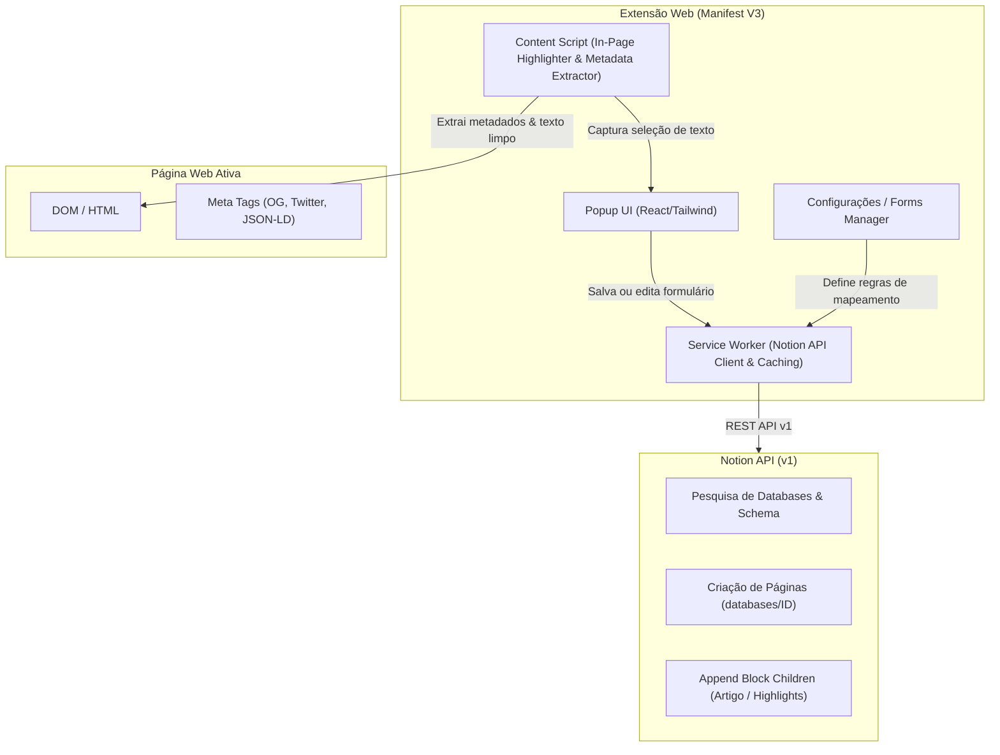

# Product Requirements Document (PRD) — Notion Web Clipper & Saver (Estilo Save.to)

---

## 1. Visão Geral do Produto (Executive Summary)

### 1.1 Contexto e Motivação
O **Save to Notion (Save.to)** tornou-se a ferramenta de referência para quem usa o Notion como "Segundo Cérebro" (*Second Brain*), superando o Web Clipper oficial da Notion. O diferencial crítico não é apenas salvar uma URL, mas permitir:
- **Múltiplos fluxos de trabalho (Forms/Workflows)** customizados por banco de dados (ex: Artigos, Vídeos, Receitas, Ideias, Vagas, Referências de Design).
- **Mapeamento dinâmico de propriedades**: tags, status, datas, checkboxes, notas rápidas diretamente na extensão antes de salvar.
- **Extração inteligente de conteúdo (Readability)**: transforma artigos da web em blocos nativos do Notion (sem poluição visual/anúncios).
- **Destaques de texto (Highlighter)** e captura de imagens/screenshots.

### 1.2 Objetivo do Projeto
Criar uma extensão de navegador (Chrome / Edge / Firefox / Brave) moderna, rápida, open-source ou de uso pessoal, com **100% das funcionalidades essenciais do Save.to**, sem limitações de planos pagos (como limite de 4 formulários do plano Free do Save.to), com foco em privacidade local e conexão direta via **Notion API**.

---

## 2. Análise Comparativa: Save.to vs. Notion Clipper Oficial vs. Nossa Extensão

| Funcionalidade | Notion Clipper Oficial | Save.to (Free / Pro) | Nossa Extensão (Notion Save) |
| :--- | :--- | :--- | :--- |
| **Destino do Salvamento** | 1 DB por vez, sem presets | 4 forms no Free (ilimitado no Pro) | **Ilimitado** (Local-First) |
| **Preenchimento de Propriedades** | Não (só Título e URL) | Sim (Tags, Status, Datas, Relações, etc.) | **Sim (Total suporte a propriedades Notion)** |
| **Autopreenchimento de Metadados** | Básico | Automático (Autor, Data, Capa, Favicon, etc.) | **Sim (OpenGraph, Twitter Cards, Schema.org)** |
| **Limpeza de Artigo (Reader Mode)** | Básico e inconsistente | Excelente (Parser em blocos Notion) | **Sim (@mozilla/readability + Notion Blocks)** |
| **Highlighter (Grifar texto na página)** | Não | Sim | **Sim (Menu contextual + floating tooltip)** |
| **Captura de Screenshots e Capas** | Não | Sim (seletor de imagem / screenshot) | **Sim (chrome.tabs.captureVisibleTab + image picker)** |
| **Autenticação** | Login Web Notion | OAuth proprietário / Conta Save.to | **Notion Internal Integration Token ou OAuth** |
| **Custo / Assinatura** | Grátis | $5.99/mês (Pro) a $17.99/mês | **100% Grátis & Código Aberto** |

---

## 3. Personas & Casos de Uso Principais

1. **Leitor & Pesquisador**:
   - Encontra artigos longos ou threads na web.
   - Quer salvar no banco "Reading List" com status `To Read`, categoria `Tech` e extrair o texto limpo para ler offline ou grifar trechos importantes.
2. **Coletor de Conteúdo / Curador**:
   - Encontra tweets/X, vídeos do YouTube, receitas ou produtos.
   - Quer salvar apenas como "Bookmark" com capa de alta resolução, autor, data e nota pessoal curta, sem salvar o corpo inteiro da página.
3. **Estudante / Segundo Cérebro (PKM - Personal Knowledge Management)**:
   - Destaca trechos-chave de estudos ou documentações e envia direto como *Quote blocks* ou *Callout blocks* dentro da página salva no Notion.

---

## 4. Arquitetura Funcional & Especificação de Módulos



---

## 5. Especificação Detalhada das Funcionalidades

### 5.1 Sistema de Formulários (Forms / Workflows)
- **Criação de Forms**:
  - O usuário pode criar quantos formulários desejar (ex: *"Artigos"*, *"Receitas"*, *"Links Rápidos"*, *"Ideias"*).
  - Cada formulário é vinculado a uma **Database** específica do Notion.
  - Seleção do modo de conteúdo:
    - **Full Content Clip**: Extrai título, metadados e o corpo limpo do artigo como blocos do Notion.
    - **Bookmark Only**: Salva apenas a página no banco com suas propriedades preenchidas (sem o corpo do artigo).
- **Mapeamento de Propriedades por Formulário**:
  - Permite configurar quais propriedades da Database do Notion aparecem no popup.
  - Tipos de valores para cada campo:
    1. **Extraído Automaticamente da Página**:
       - Título (`document.title` ou `og:title`)
       - URL (`window.location.href`)
       - Descrição / Resumo (`meta[name="description"]` ou `og:description`)
       - Imagem de Capa (`og:image` ou seletor visual)
       - Ícone / Favicon (`link[rel="icon"]`)
       - Autor (`meta[name="author"]` ou `schema.org/author`)
       - Data de Publicação (`article:published_time` ou data de hoje)
       - Tempo de Leitura estimado (cálculo de palavras por minuto)
    2. **Valor Fixo / Padrão**:
       - Exemplo: Status sempre inicia como `"A Ler"` ou Tag padrão `"Webclip"`.
    3. **Preenchimento Manual Obrigatório/Opcional**:
       - Exibe o campo no popup para o usuário selecionar na hora (ex: prioridade, tags adicionais, anotação).

### 5.2 Interface do Popup (Extensão)
- **Tela 1: Seletor de Formulários**:
  - Lista os formulários criados com ícones correspondentes.
  - Atalho de teclado para o formulário padrão.
  - Detecta se a página já foi salva anteriormente (busca por URL na database para evitar duplicidade).
- **Tela 2: Preenchimento e Pré-visualização**:
  - Miniatura da capa extraída (com botão para trocar ou remover).
  - Título editável.
  - Campos de propriedades nativos do Notion:
    - **Select / Multi-select**: Exibe as opções existentes no Notion com suas respectivas cores originais; permite criar novas opções se a API permitir.
    - **Date**: Datepicker com opção de incluir hora.
    - **Checkbox**: Toggle simples.
    - **Text / Rich Text**: Input ou Textarea.
    - **Number**: Input numérico validado.
    - **Relation**: Autocomplete pesquisando itens da database relacionada.
    - **Status**: Seletor de status com agrupamento (To Do, In Progress, Complete).
  - Botão principal: **"Salvar no Notion"** (com feedback de loading e sucesso com link direto para abrir no Notion).

### 5.3 Motor de Extração de Conteúdo (Reader & Article Parser)
- Utilização da biblioteca de alta precisão **`@mozilla/readability`** rodando no Content Script para identificar o artigo principal, descartando cabeçalhos, rodapés, anúncios e barras laterais.
- Conversor **HTML/Markdown -> Notion Block Object Model**:
  - `<h1>`, `<h2>`, `<h3>` -> `heading_1`, `heading_2`, `heading_3`
  - `<p>` -> `paragraph` (com formatação rich text: negrito, itálico, sublinhado, riscado, links e código inline)
  - `<blockquote>` -> `quote` ou `callout`
  - `<ul>` / `<ol>` -> `bulleted_list_item` / `numbered_list_item`
  - `<pre><code>` -> `code` com detecção de linguagem
  - `` -> `image` (URL externa ou upload)
  - `<table>` -> `table` com `table_row`

### 5.4 Marcador de Texto (Highlighter) & Anotações em Tempo Real
- Ao selecionar texto em qualquer página web:
  - Exibe um pequeno botão/tooltip flutuante: *"Adicionar ao Notion"*.
  - O trecho selecionado é armazenado em memória temporária da extensão para ser incluído na página ao salvar, ou adicionado como bloco em página já salva.
  - O trecho na página web recebe uma marcação visual (highlight amarelo/azul suave via content script).

### 5.5 Captura de Screenshots & Seletor de Imagens
- **Seletor de Capa**:
  - Botão *"Escolher imagem da página"*: destaca todas as imagens válidas no DOM da página com um overlay e permite clicar para definir como Page Cover.
- **Screenshot Tool**:
  - Opção para capturar a tela visível atual (`chrome.tabs.captureVisibleTab`).
  - Permite recortar área selecionada para anexar ou usar como capa.

### 5.6 Integração e Autenticação com a API do Notion
- **Método Recomendado (V1 / MVP)**: **Internal Integration Token**.
  - O usuário cria uma integração interna no Notion (grátis, em https://www.notion.so/my-integrations).
  - Concede permissão às databases desejadas.
  - Cola o Token nas configurações da extensão.
  - **Vantagens**: Sem custos de servidor backend intermediário, sem limites arbitrários de requisição, privacidade total (as chaves ficam salvas apenas no `chrome.storage.local` criptografado do usuário).
- **Método Avançado (V2)**: **Notion OAuth 2.0**.
  - Fluxo "Connect with Notion" em 1 clique para distribuição pública na Chrome Web Store.

---

## 6. Stack Tecnológica Proposta

| Camada | Tecnologia | Justificativa |
| :--- | :--- | :--- |
| **Arquitetura da Extensão** | Manifest V3 (Chrome, Edge, Firefox, Safari) | Padrão moderno e obrigatório nas lojas de extensões. |
| **Framework de Extensão** | **WXT** (ou Vite + CRXJS) | O WXT é o framework mais moderno para extensões TypeScript, com Hot Module Reloading (HMR) e suporte multi-browser nativo. |
| **Frontend UI** | **React 18/19 + Tailwind CSS + Lucide Icons** | Design limpo, ágil e fiel à estética minimalista do Notion / Save.to. |
| **Componentes UI** | Radix UI / Shadcn UI primitives | Acessibilidade, dropdowns rápidos e comportamento idêntico ao desktop. |
| **Parser de Conteúdo** | `@mozilla/readability` + `dompurify` | O mesmo motor do modo leitura do Firefox; seguro e imbatível na extração de texto limpo. |
| **Conversor de Blocos** | `martian` ou conversor customizado AST -> Notion Blocks | Garante que o HTML extraído seja convertido fielmente nas estruturas de blocos da API do Notion v1. |
| **Cliente Notion** | `@notionhq/client` (ou chamadas fetch leves via Service Worker) | Biblioteca oficial oficializada e tipada para todas as chamadas da API do Notion. |

---

## 7. Modelos de Dados (Data Schemas)

### 7.1 Configuração de Formulário (`FormConfig`)
```typescript
export interface FormConfig {
  id: string;                      // UUID único do formulário
  name: string;                    // Ex: "Artigos & Leituras"
  icon: string;                    // Emoji ou ícone Lucide
  databaseId: string;              // ID da base no Notion
  databaseTitle: string;           // Nome da database
  clipContent: boolean;            // true = Extrai texto do artigo; false = Bookmark only
  properties: PropertyMapping[];   // Regras de preenchimento de cada propriedade
  createdAt: number;
}

export type ExtractedSource = 
  | 'page_title' 
  | 'page_url' 
  | 'page_description' 
  | 'page_cover' 
  | 'page_author' 
  | 'page_date' 
  | 'reading_time'
  | 'custom_value';

export interface PropertyMapping {
  notionPropertyId: string;        // ID da propriedade na database do Notion
  notionPropertyName: string;      // Nome da propriedade (ex: "Tags", "Status", "URL")
  notionPropertyType: string;      // 'title' | 'select' | 'multi_select' | 'date' | 'url' | etc.
  source: ExtractedSource;         // De onde vem o dado por padrão
  defaultValue?: any;              // Valor padrão caso a fonte esteja vazia
  showInPopup: boolean;            // Se o usuário pode visualizar e editar no popup
  required: boolean;
}
```

---

## 8. Roadmap de Desenvolvimento em Fases

### Fase 1: Fundação & MVP (Semana 1)
- [x] Criação do repositório e scaffolding com WXT + React + Tailwind + TypeScript.
- [ ] Tela de Configuração: Inserção do Notion Integration Token e validação de conexão.
- [ ] Busca e listagem das databases disponíveis do usuário.
- [ ] Criação do primeiro Formulário básico (Título, URL e Descrição).
- [ ] Popup funcional para salvar página simples no Notion com 1 clique.

### Fase 2: Suporte Total a Propriedades & Metadados (Semana 2)
- [ ] Mapeamento dinâmico de todos os tipos de propriedades Notion (Select, Multi-Select com cores, Date, Checkbox, Status).
- [ ] Extrator robusto de metadados (OpenGraph, Twitter Cards, Canonical URL, Favicon, JSON-LD para autor/data).
- [ ] Seletor visual de imagem de capa e pré-visualização.

### Fase 3: Extração de Artigo Completo (Readability) (Semana 3)
- [ ] Integração com `@mozilla/readability` para captura limpa do texto.
- [ ] Parser para blocos nativos do Notion (parágrafos, subtítulos, listas, citações, imagens).
- [ ] Tratamento de páginas especiais (ex: suporte estruturado a links do YouTube, Github e Twitter/X).

### Fase 4: Highlighter & Polish (Semana 4)
- [ ] Marcador de texto in-page com tooltip "Salvar citação no Notion".
- [ ] Captura de screenshot de tela inteira / elemento.
- [ ] Detecção de links já salvos para evitar duplicatas.
- [ ] Empacotamento para Chrome (.zip / .crx) e documentação de instalação local.

---

## 9. Requisitos Não Funcionais (Qualidade, Performance e Segurança)
- **Privacidade & Local-First**: O token do Notion e as configurações do usuário nunca transitam por servidores de terceiros; a comunicação ocorre diretamente entre o navegador do usuário e a API da Notion (`api.notion.com`).
- **Performance**: O popup deve carregar em menos de 100ms utilizando cache local das databases e schemas (`chrome.storage.local`).
- **Resiliência a Falhas da Notion API**: Tratamento de rate limiting (código 429 com backoff exponencial) e validação de tamanho máximo de payload de blocos (blocos particionados em lotes de 100 itens conforme especificação do Notion).
