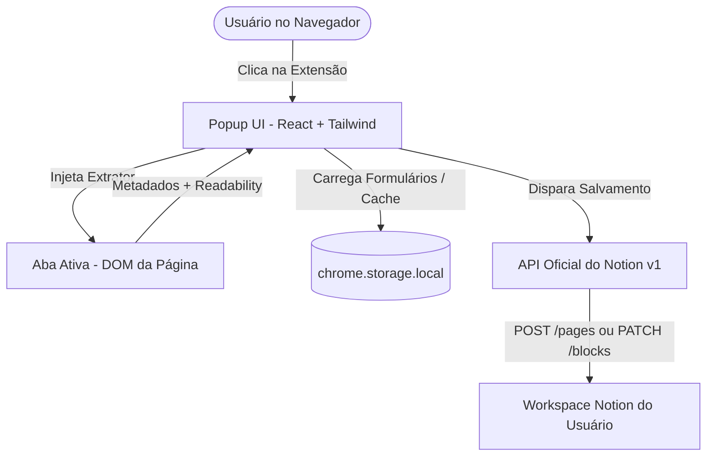

# PRD — Notion Save (Web Clipper Inteligente e Flexível)

## 1. Visão Geral do Produto
O **Notion Save** é uma extensão de navegador (Chrome, Edge, Firefox, Brave) inspirada na experiência do [Save to Notion (Save.to)](https://www.save.to). Ele permite que o usuário capture artigos, links, notas rápidas, imagens e metadados estruturados da web diretamente para suas páginas e bases de dados do Notion com 1 clique, de forma altamente customizável e sem intermediários proprietários.

---

## 2. Problema & Oportunidade
- O web clipper oficial do Notion é rígido, frequentemente falha na extração de metadados ricos e não permite mapeamento granular de propriedades do Notion nem escolha de onde e como salvar (por exemplo, salvar dentro do texto de páginas já existentes).
- Ferramentas de terceiros como o Save.to impõem limitações artificiais no plano gratuito (ex: máximo de 4 formulários) ou requerem servidores terceiros.
- **Diferencial do Notion Save**:
  - **100% Gratuito e Ilimitado**: Número ilimitado de formulários e mapeamentos.
  - **Privacidade & Segurança Local-First**: Comunicação direta entre o navegador do usuário e a API oficial do Notion através de token próprio (*Internal Integration Token*), sem backend intermediário rastreando dados.
  - **Suporte a Databases e Páginas**: Permite salvar registros em Databases relacionais ou diretamente em Páginas comuns (como sub-páginas ou blocos de anotação no final do documento).
  - **Seletor Visual de Destinos (Estilo Save.to)**: Busca rápida com filtro, visualização em árvore/breadcrumbs hierárquicos e suporte a múltiplos workspaces.

---

## 3. Personas & Casos de Uso
1. **Curador de Conteúdo / Pesquisador**:
   - Salva artigos longos limpando propagandas (modo leitura), preenchendo automaticamente tags, autor, data de publicação e resumo.
2. **Desenvolvedor / Designer**:
   - Salva repositórios do GitHub, ferramentas online e capturas de tela diretamente em uma base de recursos ou página de projeto com screenshot da página.
3. **Estudante / Produtividade Pessoal**:
   - Salva receitas, vídeos do YouTube e links rápidos com notas pessoais e status ("A Ler", "Lendo", "Concluído").

---

## 4. Arquitetura Geral do Sistema

---

## 5. Módulos e Funcionalidades Detalhadas

### 5.1 Sistema de Formulários (Workflows / Forms)
- **Criação de Formulários Ilimitados**:
  - Nome do formulário e ícone personalizado (emoji ou ícone).
  - **Destino do Formulário**:
    - **Base de Dados (Database)**: Cria uma nova linha/registro estruturado com mapeamento de colunas.
    - **Página Comum (Page)**: Cria uma **Sub-página** ou anexa blocos no final da página existente (**Append block**).
  - Modo de extração: *Extrair Artigo Completo* (corpo da página) ou *Apenas Bookmark/Metadados*.
- **Seletor Visual de Destinos (Select a Save Location - Estilo Save.to)**:
  - Campo de busca em tempo real com filtro por nome da base/página.
  - Seletor de visualização: *Databases & Pages*, *Only Databases*, *Only Pages*.
  - Exibição de breadcrumbs com a hierarquia das pastas (`Workspace / Pasta Mãe / ... / Nome`).
  - Navegação fluida para selecionar o destino do formulário.

### 5.2 Mapeamento de Propriedades (Databases)
  - Para cada propriedade da database selecionada no Notion:
    1. **Extraído Automaticamente da Página**:
       - Título (`document.title` ou `og:title`)
       - URL (`window.location.href`)
       - Descrição / Resumo (`meta[name="description"]` ou `og:description`)
       - Imagem de Capa (`og:image` ou seletor visual)
       - Ícone / Favicon (`link[rel="icon"]`)
       - Autor (`meta[name="author"]` ou `schema.org/author`)
       - Data de Publicação (`article:published_time` ou data de hoje)
       - Tempo de Leitura estimado (cálculo de palavras por minuto)
    2. **Valor Fixo / Padrão**:
       - Exemplo: Status sempre inicia como `"A Ler"` ou Tag padrão `"Webclip"`.
    3. **Preenchimento Manual Obrigatório/Opcional**:
       - Exibe o campo no popup para o usuário selecionar na hora (ex: prioridade, tags adicionais, anotação).

### 5.3 Interface do Popup (Extensão)
- **Tela 1: Seletor de Formulários**:
  - Lista os formulários criados com ícones correspondentes.
  - Alternância imediata entre diferentes destinos no Notion.
- **Tela 2: Preenchimento e Pré-visualização**:
  - Miniatura da capa extraída (com botão para trocar ou remover).
  - Seletor visual interativo de capa com imagens extraídas do DOM da página ativa ou link customizado.
  - Título editável e URL.
  - Campos de propriedades nativos do Notion:
    - **Select / Multi-select**: Exibe as opções existentes no Notion com suas respectivas cores oficiais e badges; permite adicionar tags dinamicamente.
    - **Date**: Datepicker nativo com botão de limpar.
    - **Checkbox**: Toggle/checkbox interativo.
    - **Text / Rich Text**: Input ou Textarea.
    - **Number**: Input numérico validado.
    - **Status**: Seletor de status com agrupamento.
  - Botão principal: **"Salvar no Notion"** (com feedback de loading e sucesso com link direto para abrir no Notion).

### 5.4 Extrator Inteligente de Conteúdo (Reader Mode & Metadados)
- Utilização de `@mozilla/readability` para remover anúncios, sidebars, modais de cookie e capturar apenas o texto limpo do artigo.
- Conversão limpa de elementos HTML para os blocos nativos do Notion:
  - Títulos `h1`, `h2`, `h3` -> `heading_1`, `heading_2`, `heading_3`
  - Parágrafos de texto com negrito, itálico, código inline e links
  - Citações `blockquote` -> `quote`
  - Listas ordenadas e não ordenadas -> `bulleted_list_item` e `numbered_list_item`
  - Blocos de código `pre code` -> `code`
  - Imagens `img` -> `image` (external url)

### 5.5 Marcador de Texto (Highlighter)
- Selecionar texto na página e clicar com o botão direito ou num floating tooltip para salvar o trecho destacado como citação na página do Notion.

### 5.6 Capturador de Imagens & Screenshots
- **Seletor de Capa**: Destaca todas as imagens válidas no DOM da página com um overlay e permite clicar para definir como Page Cover.
- **Screenshot Tool**: Captura a tela visível atual (`chrome.tabs.captureVisibleTab`) para anexar ou usar como capa.

### 5.7 Estratégias de Autenticação com a API do Notion
- **Método V1 (Atual - Local-First & Zero-Cost)**: **Internal Integration Token** (`API token`).
  - Sem necessidade de servidor intermediário;
  - Conexão herdada pela página mãe do workspace.
- **Método V2 (Futuro - OAuth 2.0 via Cloudflare Workers Free)**:
  - Backend serverless de autenticação hospedado 100% gratuitamente no **Cloudflare Workers**.
  - Fluxo *"Login com Notion"* oficial em 1 clique.
  - Autorização global automática de todo o Workspace sem necessidade de conectar páginas manualmente.

---

## 6. Stack Tecnológica
- **Framework de Extensão**: WXT (Manifest V3)
- **Frontend UI**: React 19 + Tailwind CSS v4 + Lucide Icons
- **Armazenamento**: `chrome.storage.local`
- **Cliente Notion**: Notion REST API v1 (`2022-06-28`)
- **Parser de Conteúdo**: `@mozilla/readability`
- **Backend OAuth Serverless (Fase Futura)**: Cloudflare Workers (Plano Gratuito de 100k reqs/dia)

---

## 7. Roadmap de Desenvolvimento em Fases

### Fase 1: Fundação & MVP (Concluído)
- [x] Repositório e scaffolding com WXT + React + Tailwind + TypeScript.
- [x] Conexão com Notion Integration Token e validação em tempo real.
- [x] Busca e listagem dinâmica de **Databases e Páginas**.
- [x] Suporte a salvar em **Databases** e em **Páginas** (como Sub-página ou Inserção de Bloco no final).
- [x] Popup funcional para salvar com 1 clique e feedback com link direto.

### Fase 2: Suporte Total a Propriedades & Metadados Avançados (Concluído)
- [x] Seletor visual de locais de salvamento (*Select a Save Location* estilo Save.to com busca em tempo real e breadcrumbs de hierarquia).
- [x] Renderização customizada de Select e Multi-Select com cores oficiais do Notion (pills e badges coloridos com opção de adicionar tags).
- [x] Datepicker nativo, Checkboxes interativos, campos numéricos e textarea no popup.
- [x] Seletor visual interativo de imagens da página para capa (inspeção do DOM com grid de miniaturas e suporte a URL externa).

### Fase 3: Extração de Artigo Completo (Readability) (Próxima)
- [ ] Captura do corpo inteiro do artigo com `@mozilla/readability`.
- [ ] Parser HTML para blocos nativos do Notion (headings, quotes, code, bullet lists).
- [ ] Suporte inteligente a links do YouTube, GitHub e Twitter.

### Fase 4: Highlighter & Polish
- [ ] Ferramenta de Highlighter para marcar textos na página web e salvar trechos.
- [ ] Captura de screenshot da tela ativa.
- [ ] Detecção de links já salvos para evitar duplicidade.

### Fase 5: Backend Cloudflare Workers & Notion OAuth 2.0 (Zero-Config)
- [ ] Criação do Cloudflare Worker para troca segura do authorization code OAuth 2.0 do Notion.
- [ ] Botão "Conectar com Notion" em 1 clique na extensão sem precisar copiar tokens manuais.
- [ ] Permissão automática para todo o workspace sem necessidade de adicionar conexões manuais em páginas.
