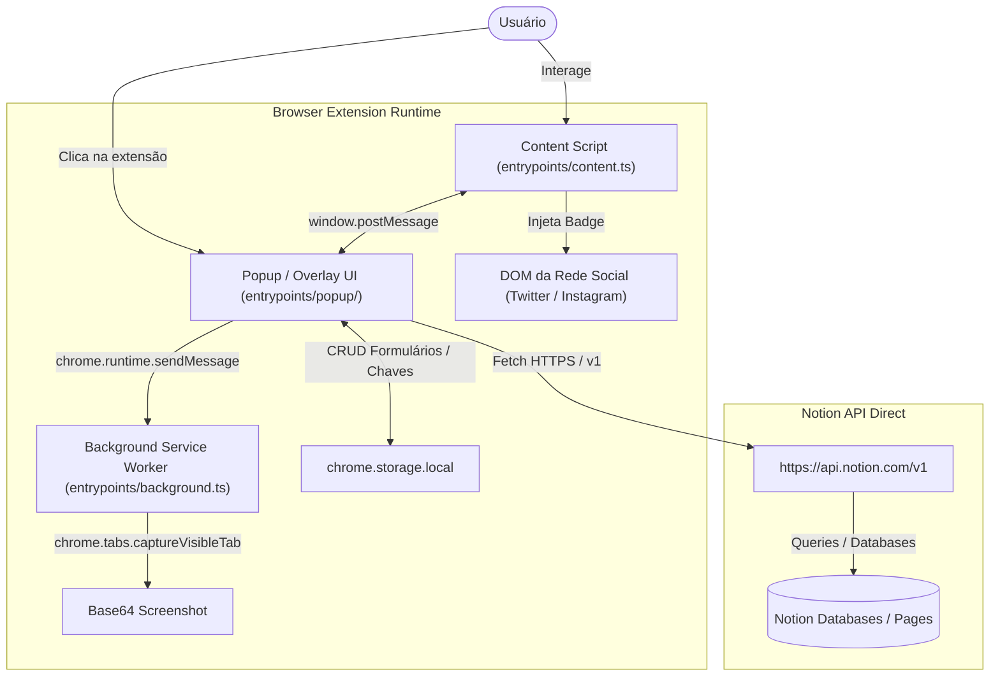

# Arquitetura do Sistema — Notion Save

Documentação técnica da arquitetura do projeto **Notion Save**, detalhando fluxo de dados, separação de responsabilidades, ciclo de vida dos componentes e estratégias de integração com o Notion.

---

## 1. Visão Geral da Arquitetura

O **Notion Save** é estruturado sobre o padrão **Manifest V3** utilizando o framework **WXT**, operando em um modelo **Local-First / Serverless** (sem servidores de intermediação). Toda a comunicação ocorre diretamente entre o navegador do usuário e a API oficial do Notion através do *Internal Integration Secret* do próprio usuário.

---

## 2. Componentes Principais e Entrypoints

### 2.1 Background Service Worker ([`entrypoints/background.ts`](file:///C:/Users/Eli/Documents/projects/notion-save/entrypoints/background.ts))
- **Papel**: Processo em segundo plano gerenciado pelo navegador (MV3).
- **Responsabilidades**:
  - Execução de ações que exigem permissões privilegiadas da extensão, especificamente `chrome.tabs.captureVisibleTab` para capturar capturas de tela (screenshots) limpas da aba ativa em formato JPEG ou PNG.
  - Comunicação assíncrona com o popup via `chrome.runtime.onMessage`.

### 2.2 Content Script ([`entrypoints/content.ts`](file:///C:/Users/Eli/Documents/projects/notion-save/entrypoints/content.ts))
- **Papel**: Injetado no contexto de cada aba web visitada pelo usuário (`<all_urls>`).
- **Responsabilidades**:
  - **Injeção de Overlay**: Cria e gerencia um iframe isolado para renderizar o popup como um modal flutuante na página (ativado via atalhos ou clique em badges sociais).
  - **Element Picker Interativo**: Sistema de destaque visual (overlay verde com coordenadas) para seleção de elementos arbitrários na página com cancelamento por tecla `ESC` ou botão de cancelamento.
  - **Social Media Badges**: Integração contínua com feeds do Twitter/X e Instagram via `MutationObserver` para posicionar os botões "Salvar no Notion".

### 2.3 Interface do Usuário ([`entrypoints/popup/`](file:///C:/Users/Eli/Documents/projects/notion-save/entrypoints/popup/))
- **Papel**: Aplicação React de página única (SPA) que atua tanto na barra de ferramentas do navegador quanto dentro do iframe overlay.
- **Roteamento Interno**:
  - `SelectFormView`: Apresentação rápida dos formulários de salvamento disponíveis para a página atual, com contador de campos e acesso às configurações.
  - `SavePageView`: O formulário interativo de salvamento estilo *Save.to*, permitindo edição de título, URL, capas, tags, campos extras e seleção do modo de clip.
  - `CreateFormView`: Configuração, mapeamento de colunas da base do Notion e customização de novos formulários.
  - `SettingsView`: Gestão de token de integração do Notion e revalidação de permissões.

---

## 3. Camada de Serviços e Integrações

### 3.1 Cliente da Notion API ([`src/services/notion.ts`](file:///C:/Users/Eli/Documents/projects/notion-save/src/services/notion.ts))
A comunicação com a API do Notion é feita diretamente via requisições `fetch` com os headers:
- `Authorization: Bearer <API_KEY>`
- `Notion-Version: 2022-06-28`
- `Content-Type: application/json`

Funcionalidades implementadas:
1. **Busca Paginada de Destinos (`getNotionDatabasesAndPages`)**:
   - Varre o endpoint `/v1/search` com paginação automática (`start_cursor`) até listar todas as databases e páginas compartilhadas com a integração, ordenadas por modificação recente.
2. **Criação de Páginas (`createPage`)**:
   - Suporta criação tanto dentro de databases (`parent: { database_id }`) quanto como subpáginas (`parent: { page_id }`).
   - Mapeia propriedades dinâmicas conforme a tipagem da tabela (`title`, `rich_text`, `select`, `multi_select`, `date`, `checkbox`, `number`, `url`).
   - Insere o conteúdo principal no Canvas (`children` blocks).
3. **Anti-Duplicação (`findExistingPageByUrl`)**:
   - Executa consulta filtrada por URL na base selecionada para avisar visualmente se o link já foi salvo anteriormente.
4. **Criação Dinâmica de Tags (`addSelectOptionToDatabase`)**:
   - Atualiza o schema da database via `PATCH /v1/databases/{id}` quando o usuário digita uma opção inexistente no campo Select/Multi-Select.

### 3.2 Extração de Artigos e Conteúdo ([`src/services/reader.ts`](file:///C:/Users/Eli/Documents/projects/notion-save/src/services/reader.ts))
- Utiliza `@mozilla/readability` para higienizar artigos, removendo anúncios, menus, rodapés e elementos de rastreamento.
- Transforma a árvore DOM higienizada em uma lista encadeada de blocos nativos da Notion API:
  - `paragraph` com fragmentação de rich_text
  - `heading_1`, `heading_2`, `heading_3`
  - `bulleted_list_item` e `numbered_list_item`
  - `image` externa
  - `code` e `quote`

### 3.3 Módulo de Redes Sociais ([`src/services/socialMedia.ts`](file:///C:/Users/Eli/Documents/projects/notion-save/src/services/socialMedia.ts))
Especializado em lidar com o comportamento dinâmico e o DOM ofuscado de plataformas sociais:
- **Instagram**:
  - Suporta feeds contínuos, páginas individuais (`/p/`, `/reel/`) e modais abertos (`div[role="dialog"]`).
  - Aciona expansão automática de textos truncados (`... mais` / `… more`).
  - Isola elementos do autor (`header`) e foca na tag `<h1>` ou no corpo da legenda, ignorando contadores de curtidas e botões de interface.
- **Twitter/X**:
  - Extrai dados a partir de elementos `article[data-testid="tweet"]`, recuperando handle, URL canônica e expandindo links "Show more".

---

## 4. Estratégia de Conteúdo no Canvas do Notion

Para contornar as limitações de expiração de mídias e restrições de schema de bancos de dados:

1. **Embeds Nativos (Iframes)**:
   - Para posts do Twitter/X e Instagram, gera-se um bloco `embed` com a URL do post. O Notion renderiza o player/card oficial interativo, garantindo que o conteúdo permaneça acessível sem quebrar com URLs de CDN temporárias.
2. **Chunking de Rich Text (Limite de 2.000 caracteres)**:
   - Cada bloco de texto da Notion API aceita no máximo 2.000 caracteres. Textos ou legendas que excedam essa marca são fatiados em múltiplos blocos `quote` consecutivos de 1.800 a 1.900 caracteres.
3. **Mapeamento Multilíngue e Fallbacks**:
   - A legenda é sempre adicionada ao corpo (Canvas). Se o banco de dados contiver uma propriedade para descrição (`Description`, `Descrição`, `Descricao`, `Legenda`, `Caption` ou `Resumo`), ela também será preenchida.

---

## 5. Armazenamento e Rascunhos

- **`chrome.storage.local`**:
  - Armazena a chave de API (`notionApiKey`) de maneira persistente e segura na máquina do usuário.
  - Armazena a lista de formulários configurados (`notion_forms`), seus mappings de propriedades e opções de cache.
- **`localStorage` (Rascunhos Efêmeros)**:
  - Salva rascunhos de digitação a cada caractere alterado no formulário ativo (`notion_save_draft_${formId}_${url}`).
  - Se o usuário fechar o popup acidentalmente ou clicar fora, os dados preenchidos são restaurados na reabertura.
