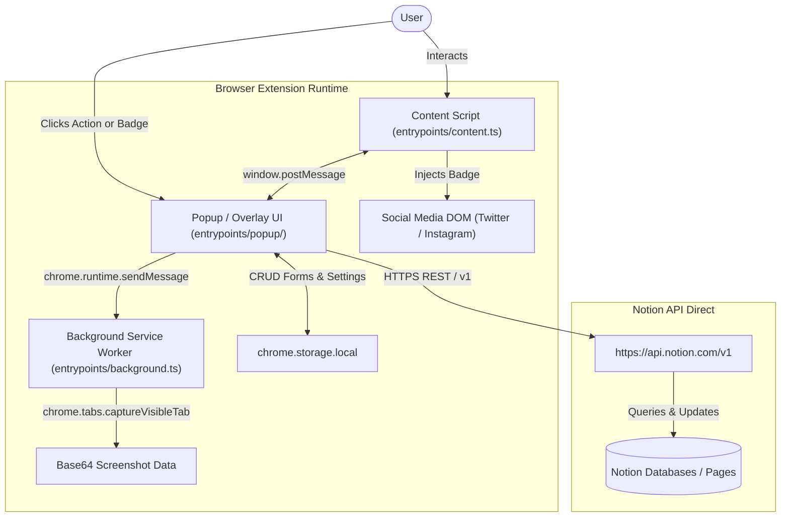

# System Architecture — Notion Save

Technical documentation detailing data flow, separation of concerns, component lifecycles, and Notion API integration strategies.

---

## 1. High-Level Architecture Overview

**Notion Save** is built on **Chrome Manifest V3** powered by the **WXT** framework. It operates under a **Local-First / Serverless** architecture: there are no intermediary backend proxies. All operations occur directly between the client browser and the official Notion REST API using the user's *Internal Integration Secret*.

---

## 2. Core Components & Extension Entrypoints

### 2.1 Background Service Worker ([`entrypoints/background.ts`](../entrypoints/background.ts))
- **Role**: Background execution environment managed by the browser lifecycle.
- **Responsibilities**:
  - Executes privileged WebExtension APIs unavailable inside standard web pages or iframes, specifically `chrome.tabs.captureVisibleTab` for capturing visible viewport screenshots in JPEG format.
  - Listens to internal messages via `chrome.runtime.onMessage`.

### 2.2 Content Script ([`entrypoints/content.ts`](../entrypoints/content.ts))
- **Role**: Injected into web pages matching `<all_urls>`.
- **Responsibilities**:
  - **Modal Overlay Injection**: Creates an isolated iframe container rendering the popup UI directly over the target web page.
  - **Interactive Element Picker**: Visual element inspection and bounding box overlay with cancellation via `ESC` key or an on-screen cancel button.
  - **Social Media Badging**: Continuous observer (`MutationObserver`) injecting "Save to Notion" buttons into Twitter/X feeds and Instagram feeds/dialogs.

### 2.3 User Interface Application ([`entrypoints/popup/`](../entrypoints/popup/))
- **Role**: Single Page React application serving both the toolbar popup and page overlay modal.
- **Internal Views**:
  - [`SelectFormView`](../src/components/SelectFormView.tsx): Fast selection of configured workflows with destination indicators and quick links.
  - [`SavePageView`](../src/components/SavePageView.tsx): The primary clipping form inspired by Save.to, featuring title, URL, tag selectors, image picker, screenshot trigger, and expandable custom fields.
  - [`CreateFormView`](../src/components/CreateFormView.tsx): Workflow configuration, dynamic database/page selector, and field mapping editor.
  - [`SettingsView`](../src/components/SettingsView.tsx): Notion API key management, workspace connection testing, and workflow management.

---

## 3. Services & Integration Layer

### 3.1 Notion API Client ([`src/services/notion.ts`](../src/services/notion.ts))
Direct REST communication with Notion API endpoints using standard headers:
- `Authorization: Bearer <API_KEY>`
- `Notion-Version: 2022-06-28`
- `Content-Type: application/json`

Key capabilities:
1. **Paginated Destination Search (`getNotionDatabasesAndPages`)**:
   - Recursively traverses `/v1/search` with `start_cursor` pagination to list all databases and parent pages shared with the integration.
2. **Page Creation (`createPage`)**:
   - Supports creating pages inside databases (`parent: { database_id }`) or nested subpages (`parent: { page_id }`).
   - Translates dynamic field mappings to Notion property objects (`title`, `rich_text`, `select`, `multi_select`, `date`, `checkbox`, `number`, `url`).
   - Appends formatted blocks to the page canvas via `children`.
3. **Anti-Duplication Guard (`findExistingPageByUrl`)**:
   - Queries database pages matching the current canonical URL to alert the user if the link has already been clipped.
4. **Dynamic Tag Creation (`addSelectOptionToDatabase`)**:
   - Dynamically updates database schemas via `PATCH /v1/databases/{id}` when users input new select/multi-select tags on the fly.

### 3.2 Web Article Parsing ([`src/services/reader.ts`](../src/services/reader.ts))
- Integrates `@mozilla/readability` to isolate core article text, stripping navigation menus, ads, and trackers.
- Converts the cleaned DOM structure into native Notion blocks:
  - `paragraph` (with inline annotations)
  - `heading_1`, `heading_2`, `heading_3`
  - `bulleted_list_item` and `numbered_list_item`
  - `image` (external source)
  - `code` and `quote`

### 3.3 Social Media Extraction ([`src/services/socialMedia.ts`](../src/services/socialMedia.ts))
Handles dynamic DOM structures and client-side routing on social platforms:
- **Instagram**:
  - Traverses from target buttons up to root post wrappers (`div[role="dialog"]`, `article`).
  - Auto-expands truncated captions (`... more` / `… mais`).
  - Scrapes author username and post ID (`/p/`, `/reel/`), isolating captions from UI counters.
- **Twitter/X**:
  - Parses `article[data-testid="tweet"]`, extracting handles, tweet IDs, and full tweet text.

---

## 4. Notion Canvas Strategy

To avoid CDN link expirations and Notion database schema constraints:

1. **Interactive Embeds**:
   - For Twitter/X and Instagram posts, native `embed` blocks are added to the canvas. Notion renders the official interactive widget, eliminating broken images caused by expiring CDN URLs.
2. **Rich Text Chunking (2,000 Character Boundary)**:
   - Notion blocks restrict each rich text segment to 2,000 characters. Captions and long paragraphs are sliced into chunks (1,800–1,900 chars) rendered as consecutive `quote` blocks.
3. **Multilingual Property Fallback**:
   - Social post captions are always guaranteed in the canvas. If the destination database also defines a description column (`Description`, `Descrição`, `Descricao`, `Legenda`, `Caption`, or `Resumo`), it is populated concurrently.

---

## 5. Storage & Draft Resilience

- **`chrome.storage.local`**:
  - Securely stores the Notion API key (`notionApiKey`) on the client machine.
  - Persists workflow configurations (`notion_forms`), property mappings, and database cache items.
- **`localStorage` (Ephemeral Drafts)**:
  - Real-time draft auto-save keyed by form ID and URL (`notion_save_draft_${formId}_${url}`).
  - Automatically restores user modifications if the popup closes unintentionally and clears the draft upon successful save.
